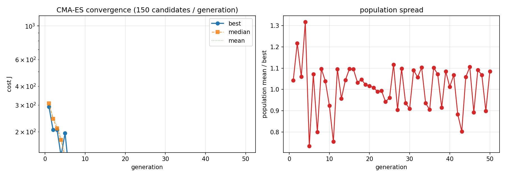
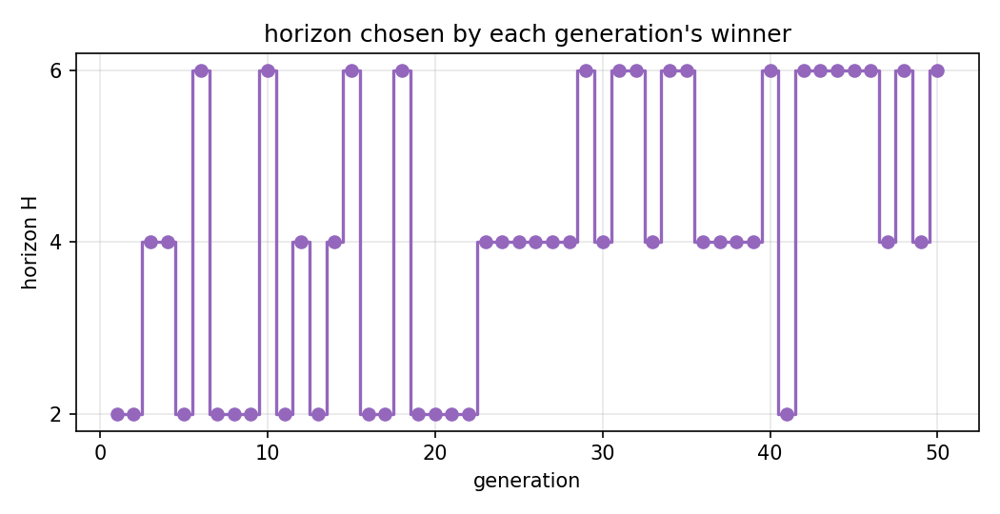
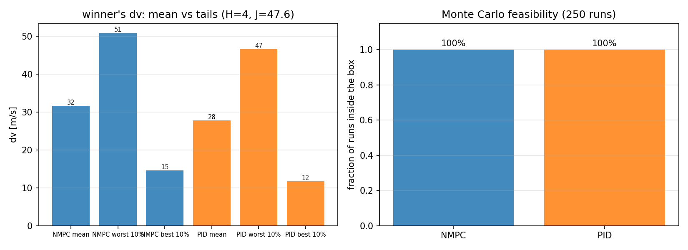

# NMPC + PID station-keeping: global hypercube sweep

Generated 2026-10-09 13:35 UTC  
Git `8e5ad0a5`(dirty working tree)

## Result

- **Cost 47.56**, down from 291.99 at generation 1 (**83.7%** reduction)
- Horizon **H=4** (optimised, not fixed)
- Both arms **100% feasible**: NMPC 100%, PID 100% of 50 Monte Carlo runs
- 50 generations, popsize 50, 4 workers, **1h 18m** wall
- Reached within 5% of the final answer at **generation 26**

> **Statistical caveat.** This run used 50 Monte Carlo samples, so each tail mean is over **5 runs**. The worst-decile term carries half the cost, and a 5-sample tail has a standard error of roughly 45% of the tail's own spread. Treat the tail-weighted cost as indicative and re-score the winner with `--runs 250` before quoting a precise value; the feasibility fraction and dv mean are far better determined.

## Monte Carlo statistics of the winner

| quantity | NMPC | PID |
|---|---|---|
| dv mean [m/s] | 31.714 | 27.801 |
| dv median [m/s] | 29.924 | 26.214 |
| dv p90 [m/s] | 45.711 | 41.169 |
| dv p99 [m/s] | 54.131 | 49.836 |
| dv min [m/s] | 9.394 | 7.217 |
| dv max [m/s] | 57.202 | 50.909 |
| worst-decile cost | 50.914 | 46.618 |
| best-decile cost | 14.575 | 11.742 |
| box mean [km] | 8.719 | 7.432 |
| box max [km] | 24.814 | 23.562 |
| feasible fraction | 1.00 | 1.00 |
| infeasible runs | 0 | 0 |

`tail_hi`/`tail_lo` are the weighted decile means the cost is built from (`--w-hi`/`--w-lo`), so they are cost units, not raw dv.

## Tuned parameters

Physical values. Each is the natural log of an optimiser coordinate; the log-space vector is in `params_best.json`.

| parameter | value | unit |
|---|---|---|
| `box_r` | 0.0101465 | m |
| `db_a` | 10319.7 | m |
| `horizon` | 4 | steps |
| `kd_n` | 0.0418081 | - |
| `kd_r` | 0.0160831 | - |
| `ki_n` | 9.49674e-09 | - |
| `ki_r` | 9.05545e-12 | - |
| `ki_t` | 3.17457e-09 | - |
| `kp_n` | 2.15793e-06 | - |
| `kp_r` | 2.0677e-07 | - |
| `kp_t` | 0.0338032 | - |
| `q_pos` | 0.013203 | - |
| `q_vel` | 32.8626 | - |
| `r_fuel` | 0.171493 | - |
| `trim_a_max` | 0.0282016 | m/s^2 |
| `trim_dv_budget` | 22.4334 | m/s |

## Configuration

Reproduce with:

```
./env/bin/python -m cubesat_12u_sim.tuning.run_mc_optimize --generations 50 --popsize 50 --runs 50 --vehicles 25 --workers 4 --seed 20261007 --checkpoint ckpt_mc.json
```

| setting | value |
|---|---|
| search space | 16-D hypercube (log-space), horizon discrete |
| restarts | 0 (single CMA-ES run) |
| popsize | 50 |
| generations | 50 |
| CMA-ES seed / sigma0 | 20261007 / 0.3 |
| Monte Carlo runs | 50 (25 vehicles x 2 injections) |
| runs per decile | 5 |
| MC seed | 20261007 |
| closed loop | 0.5 d, outer 600 s, inner 60 s |
| station-keeping box | 25 km |
| SLSQP maxiter | 50 |
| Taylor tolerance | 1e-12 |
| cost weights | w_hi 0.5, w_lo 0.5, w_nmpc 0.5, w_pid 0.5, w_infeasible 1000, tail_frac 0.1 |

### Dispersion model

| quantity | bias | 1-sigma |
|---|---|---|
| injection velocity error | -0.0050 | 0.0020 |
| injection position error | 0 | 5.0e-04 |
| bus mass | 0 | 0.05 |
| thruster scale | 0 | 0.05 |
| allocator efficiency | 0.5 | 0.05 |

## Convergence





Per-generation numbers are in `convergence.csv`. Note that `best_cost` is **not monotone**: the search oscillates around a noise floor, which is why the reported winner is the cheapest *evaluated* candidate rather than the last generation's.



## Provenance

| quantity | produced by |
|---|---|
| cost | `mcobjective.reduce_arm, weighted tails over 50-run design` |
| dv | `_nmpc_batch / _pid_group (full C++ closed loop)` |
| design | `mcdesign.build_design, frozen from config.mc.seed` |
| params | `params.HYPER_SPACE.from_theta` |
| horizon | `params.MC_HORIZONS (discrete coordinate 15)` |

## Files

| file | contents |
|---|---|
| `params_best.json` | winner as physical + log-space vectors |
| `results_best.json` | winner's full per-arm Monte Carlo statistics |
| `convergence.csv` | one row per generation |
| `mc_design.csv` | per-run Monte Carlo table |
| `config_used.json` | every setting, plus git state |
| `figures/` | the three figures |
| `reproduce.sh` | the command that produced this run |
